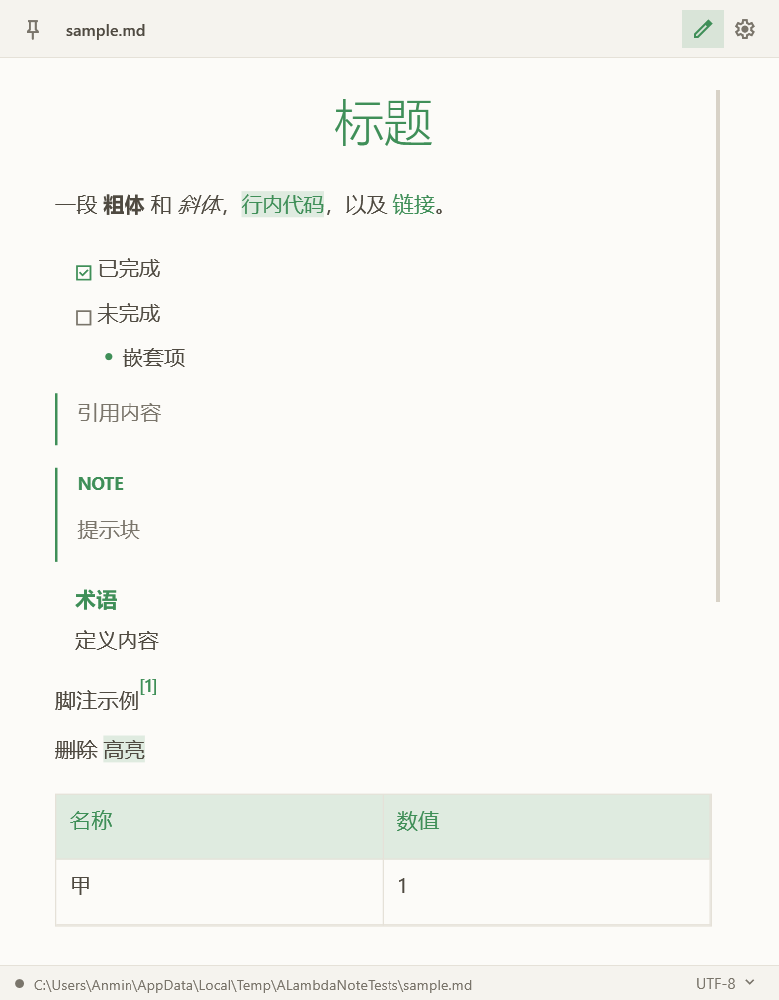
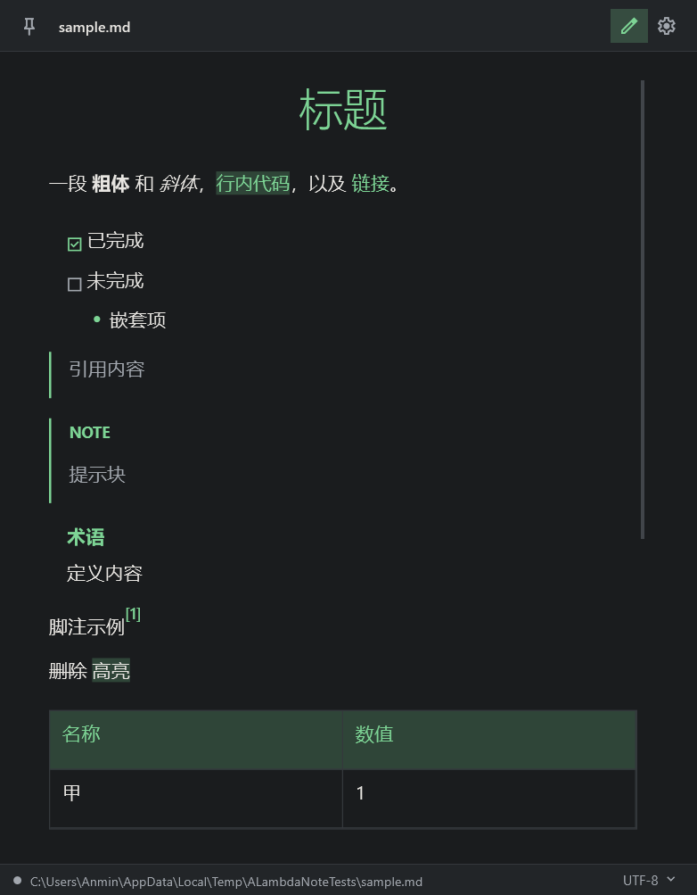

# ALambda Note

by Anming_cat (软件是我用 deepseek 开发的, 代码均由 AI 生成(其实README也是)

轻量、快速、简单的 Markdown / 纯文本编辑器。基于 .NET 10 + WPF，界面走了鲜明但克制、直角、无多余装饰的路线。

GitHub 仓库：<https://github.com/Anming1379/ALambdaNote>  
最新安装包见 [Releases](https://github.com/Anming1379/ALambdaNote/releases)。当前版本：**v1.1.3**。





## 功能

- Markdown 与纯文本编辑，始终按 Markdown 语法高亮，不依赖文件后缀。
- 编辑区默认 17 号字，使用 Dubai / Segoe UI 比例字体，不做等宽排版；编辑区行距按 2.0 倍字号拉开，滚动到任意位置都保持同样的行高。预览里的代码使用随包内置的 Lekton 等宽字体，中文字符自动回退到系统字体。工具栏文件名单击（或按 F2）可以重命名当前文件；未保存文件会先直接编辑名字，不弹保存对话框。
- 一级标题使用主题色 300 字重并居中显示，二级标题使用主题色 300 字重左对齐，三级到六级标题字号层级继续拉开；编辑区的标题、代码块和分隔线同样使用主题色。
- Markdown 预览支持标题、段落、粗体/斜体/删除线/高亮/上下标、行内代码、围栏代码块、引用、GitHub 风格提示块、有序/无序/任务/嵌套列表、表格、分割线、链接、脚注、定义列表、本地与网页图片，以及 HTML ``；图片支持 SVG / SVGZ 和 data URI。行内代码、围栏代码、列表符号、任务勾选、表头、定义术语、分割线和链接都会跟随主题色。无序列表圆点用几何图形绘制，避免字体基线造成的上下偏移。
- 预览模式只读，可选中复制；链接、图片和加载失败的占位块都可以点击，交给系统浏览器打开。
- 深色 / 浅色 / 跟随系统三档主题，原生标题栏也会一起变色；应用通过 `app.manifest` 声明 PerMonitorV2 DPI 感知，高 DPI 下不会让 Windows 把整窗位图放大。
- 每次启动从 7 个高辨识度预设色里随机挑一个主题色，也可以在设置里固定。
- 文件编码自动探测（ANSI / UTF-8 / UTF-8 BOM / UTF-16 LE / UTF-16 BE），打开后保持原编码写回；新建文件默认 ANSI。
- 保持源文件换行风格（CRLF / LF）。
- 状态栏保存指示灯、完整路径、编码切换。
- 拖入文件直接打开，以文件关联或拖入方式打开时默认进入预览；打开空文件（包括只有 BOM 或换行的文件）时直接进入编辑模式，并在启动时再做一次兜底。
- 预览正文最大宽度 720 DIP，宽窗口自动居中，避免一行拉得太长。
- 预览结果会缓存，编辑与预览之间切换时不重复解析 Markdown；发布包启用 ReadyToRun 改善启动。
- 窗口置顶、记住窗口大小、每次启动居中、默认竖版窗口。

## 快捷键

| 快捷键 | 功能 |
| --- | --- |
| `Ctrl+N` | 新建 |
| `Ctrl+O` | 打开 |
| `Ctrl+S` | 保存 |
| `Ctrl+Shift+S` | 另存为 |
| `Ctrl+P` | 预览 / 编辑切换 |
| `F2` | 重命名当前文件 |

另外，右键工具栏上的文件名可以打开新建、打开、保存、另存为、重命名、在文件夹中显示。右键预览区可以复制或全选。编辑区和预览区都使用平滑滚轮翻页；切换预览/编辑时会按当前滚动比例同步位置，滚动条在底部也能来回保持。切换模式、拖入文件提示和弹出菜单都带轻量过渡动画。

## 默认保存位置

新建文件默认保存到：

```text
文档\ALambda Note\
```

可以在设置里修改。打开已有文件后保存，仍然覆盖源文件。

## 设置

设置保存在：

```text
%APPDATA%\ALambdaNote\settings.json
```

包含主题模式、主题色、窗口大小、编辑字号、默认保存目录。窗口位置不保存，每次启动都居中。

## 图片

- 支持 ``、``、带空格的相对/绝对本地路径，以及 HTML ``。
- 相对路径按当前 Markdown 文件所在目录解析；新建且尚未保存的文档按启动目录解析。
- 网页图片带浏览器 UA 和来源页 Referer；遇到防盗链返回 401/403/406 时会自动去掉 Referer 重试一次。
- 加载失败时占位块会直接显示原因（HTTP 状态、超时、网络不可用、找不到文件、格式不支持等）；Cloudflare 的浏览器验证会被标成“网站要求浏览器验证”，点击占位块或图片可以用默认浏览器打开。
- 位图解码依赖 Windows 自带的 WIC：PNG / JPEG / GIF / BMP / TIFF / ICO 稳定支持；WebP / AVIF / HEIC 取决于系统是否装了对应解码扩展，缺失时会显示明确提示。
- SVG / SVGZ 由纯托管 SharpVectors 解析，保留为 WPF 矢量 `DrawingImage`，预览缩放时不会发糊；透明背景、只有 `viewBox` 的 SVG 也能处理，并复用内存缓存。
- 动画型 SVG 会优先静态化显示：移除动画、保留静态文字；`textPath` 会回退成普通文字，同位置的多条动画文字会纵向展开而不是丢掉，内嵌 `@font-face` 字体数据不会阻塞解析。没有扩展名、Content-Type 不规范或前面带 XML 注释的 SVG 也会按内容识别。
- 支持 `data:image/...;base64,...` 和百分号编码的 data URI，SVG 也可以直接内嵌为 data URI。

## 安装包

```powershell
powershell -ExecutionPolicy Bypass -File build-installer.ps1
```

脚本会先发布 win-x64 单文件版本，再调用 Inno Setup 6 编译安装包：

```text
installer\Output\ALambdaNote-Setup-1.1.3.exe
```

安装包特性：

- 安装时检测 `Microsoft.WindowsDesktop.App` 的 `10.x` 运行时；缺失则自动调用 `assets/install-dotnet.ps1` 下载并安装 .NET 10 桌面运行时（约 60 MB，控制台会显示下载进度）。
- 可选创建桌面快捷方式，可选关联 `.md` / `.markdown` / `.txt` 文件；这三种文件统一使用独立的文本文件图标，应用本身仍使用 app.ico。
- 卸载时保留 `%APPDATA%\ALambdaNote\settings.json`，不删除个人设置。
- 安装包未做代码签名，首次运行可能触发 SmartScreen 提示；需要管理员权限写入 Program Files 和文件关联。

## 构建

```bash
dotnet build
dotnet run
```

依赖：

- [AvalonEdit](https://github.com/icsharpcode/AvalonEdit)：编辑区与语法高亮的基础设施
- [Markdig](https://github.com/xoofx/markdig)：Markdown 解析，渲染由项目内的 `MarkdownRenderer` 翻译成 WPF `FlowDocument`
- [SharpVectors](https://github.com/ElinamLLC/SharpVectors)：SVG / SVGZ 解析与 WPF 矢量渲染
- Lekton：Markdown 预览代码等宽字体（SIL OFL 1.1，见 `assets/Lekton-OFL.txt`）

仓库里的 `NuGet.config` 只保留了 `nuget.azure.cn` 镜像（本机直连 nuget.org 会 SSL EOF）。换环境时按需调整。

## 自检

项目里带了一个进程内 UI 自检程序，不依赖截图，直接创建真实窗口、读控件树与 FlowDocument，并把窗口渲染成位图检查配色：

```bash
dotnet run --project tests/UiHarness
```

覆盖主题与主题色覆盖、编辑区行高（含滚动后的可视行）、自动换行长行的命中测试、光标矩形对齐、编码往返、脏标记、预览渲染、图片加载（含本地 / 远程 / data URI SVG、SVGZ、viewBox-only SVG、无扩展名 SVG、动画 SVG 静态回退与多行 textPath）、空文件默认编辑（空文件 / BOM / 换行）、预览复制、保存写回、文件名单击重命名、滚轮滚动、编辑↔预览滚动同步、拖入打开、原生标题栏深浅标志、默认窗口尺寸、设置窗口结构等。

## 结构

```text
ALambdaNote/
├─ App.xaml(.cs)                 启动、主题初始化、系统主题监听、崩溃日志
├─ app.manifest                   PerMonitorV2 DPI 感知
├─ MainWindow.xaml(.cs)          工具栏 / 编辑区 / 状态栏与全部交互
├─ Services/
│  ├─ AppSettings.cs             设置模型
│  ├─ SettingsStore.cs           JSON 持久化
│  ├─ ThemeManager.cs            深浅主题、随机主题色、资源画刷
│  ├─ NativeTheme.cs             原生标题栏跟随主题
│  ├─ TextFileService.cs         编码探测、读写、换行保持
│  ├─ MarkdownRenderer.cs        Markdig AST -> FlowDocument
│  ├─ MarkdownColorizer.cs       编辑区语法高亮
│  └─ ImageLoader.cs             本地 / 网页图片异步加载
├─ Views/
│  ├─ FlatDialog.xaml(.cs)       直角确认与提示弹窗
│  └─ SettingsWindow.xaml(.cs)   设置界面
├─ installer/ALambdaNote.iss     Inno Setup 安装包脚本
├─ build-installer.ps1           发布 + 编译安装包
├─ Themes/Styles.xaml            全部控件样式
└─ tests/UiHarness/              进程内自检
```

## 更新记录

### 1.1.3

- Windows 10 默认使用 WPF 软件渲染，避开旧显卡/驱动在硬件合成下出现的启动白屏；Windows 11 继续使用硬件渲染。需要强制硬件渲染时可设置环境变量 `ALAMBDA_HARDWARE_RENDERING=1`。
- Windows 10 不再设置只有 Windows 11 支持的 DWM 标题栏颜色属性。
- 启动、从最小化恢复和最大化后增加原生 `RedrawWindow` + `DwmFlush`，确保客户区真正提交到屏幕。
- 新增 `ALAMBDA_SOFTWARE_RENDERING=1` 用于手动强制软件渲染，方便排查显卡问题。

### 1.1.2

- 修复窗口最小化且存在未保存修改时，关闭确认框被藏在任务栏后、软件无法关闭的问题；关闭前会先恢复并激活主窗口。
- 修复启动淡入动画在最小化时停在透明状态，导致最大化黑屏、强制关闭后重新启动白屏的问题；启动和窗口状态切换不再使用整窗淡入。
- 窗口从最小化恢复或最大化后会强制恢复内容层可见性并重绘客户区，避免 Windows 10 合成状态切换后出现黑屏。
- 自检新增最小化关闭、启动可见性、最大化重绘和非空白渲染检查。

### 1.1.1

- Markdown 预览中的围栏代码、行内代码和数学公式改用随包内置的 Lekton 等宽字体；中文和缺失字形自动回退到系统字体。
- 修复 CRLF 换行源码中代码块行尾残留 `\r` 的问题。
- 自检新增 Lekton 字体资源、行内代码和围栏代码字体检查。

### 1.1.0

- 修复编辑区光标和选中位置错位：编辑区行距改由字体度量统一控制，`TextLine`、`VisualLine`、光标矩形和鼠标命中测试共用同一套高度；自动换行的长行、滚动后可视行和从第二段开始选中都不再漂移。
- 自检新增自动换行长行命中、第二段命中与光标矩形对齐检查。

## License

本项目使用 [MIT License](LICENSE) 开源。
